<div align="center">



# 🏷️ Awesome Data Labeling Quality Control Systems

<p align="center">
<a href="https://github.com/ishandutta2007/Awesome-Awesome-Awesome"></a><a href="https://discord.gg/jc4xtF58Ve"></a>
<a href="https://github.com/ishandutta2007/Awesome-Awesome-Awesome"></a>
<a href="https://github.com/ishandutta2007/Awesome-Data-Labeling-Quality-Control-Systems/stargazers"></a>
<a href="https://github.com/ishandutta2007/Awesome-Data-Labeling-Quality-Control-Systems/network/members"></a>
<a href="https://github.com/ishandutta2007/Awesome-Data-Labeling-Quality-Control-Systems/issues"></a>
<a href="https://github.com/ishandutta2007/Awesome-Data-Labeling-Quality-Control-Systems/blob/main/LICENSE"></a>
<a href="https://github.com/ishandutta2007"></a>
</p>

**A curated directory of leading SaaS platforms and open-source GitHub projects for Data Labeling Quality Control (QC), Inter-Annotator Agreement (IAA), automated label error validation, and human-in-the-loop (HITL) dataset curation.**

</div>

---

> 🎯 **Why Quality Control in Data Labeling Matters**: Data quality fundamentally governs model accuracy. Systematic label errors and noisy annotations degrade training convergence, hurt downstream task generalization, and corrupt LLM alignment. This repository tracks statistical frameworks, consensus algorithms, and QA tooling designed to catch annotation inconsistencies, calculate rigorous inter-rater metrics (Cohen's Kappa, Fleiss' Kappa, Krippendorff's Alpha), identify label noise, and guarantee high-integrity machine learning training pipelines.

---

## 📑 Table of Contents

- [📊 Sector Overview & Market Dynamics](#-sector-overview--market-dynamics)
- [🏢 SaaS & Hosted Platforms](#-saas--hosted-platforms)
- [💻 Open-Source GitHub Projects](#-open-source-github-projects)
  - [⚡ Open-Source Tooling Comparison](#-open-source-tooling-comparison)
  - [🔍 Comprehensive Project Profiles](#-comprehensive-project-profiles)
- [📐 Key Metrics & Evaluation Frameworks](#-key-metrics--evaluation-frameworks)
- [🌟 Star History](#-star-history)
- [💖 Support & Community](#-support--community)
- [🤝 How to Contribute](#-how-to-contribute)
- [⚖️ Disclaimer & Best Practices](#️-disclaimer--best-practices)

---

## 📊 Sector Overview & Market Dynamics

The global AI data labeling and annotation solutions market is valued at **$1.6B–$2.3B in 2025–2026** and projected to surge past **$17B–$25B by 2030** with an explosive compound annual growth rate (CAGR) of 20%–28%, heavily driven by LLM reinforcement learning from human feedback (RLHF), multimodal vision-language foundation models, and physical AI robotics.

The sector exhibits **moderate fragmentation with aggressive consolidation at the enterprise tier**: while lower-tier manual workforce fulfillment remains distributed across thousands of regional BPO vendors and crowdsourcing agencies, top enterprise software contracts and foundational lab partnerships are increasingly dominated by a concentrated cluster of category leaders (such as Scale AI, Snorkel AI, and Labelbox) offering integrated quality control workflows, programmatic labeling, and model-assisted consensus.

---

## 🏢 SaaS & Hosted Platforms

The table below catalogs premier commercial SaaS data labeling and quality control platforms. All companies are **sorted in descending order by company scale (Valuation / Estimated Revenue)**.

| Company & Platform | Valuation / Company Scale | Pricing (Starting Tier) | Free Tier Limits / Trial Limits | Core Focus & Quality Control Capabilities |
| :--- | :--- | :--- | :--- | :--- |
| **[Scale AI](https://scale.com/)** | **$29B valuation** (~$1.5B–$2.0B ARR) | **$0.05 / unit** (Scale Rapid self-serve data engine); custom enterprise quotes for managed workforce | **200 free labeling units/month** (via Scale Rapid self-serve API) | Managed global workforce (240k+ labelers), Scale Donovan (defense/gov), Scale GenAI (RLHF & prompt curation for frontier models). |
| **[Snorkel AI (Snorkel Flow)](https://snorkel.ai/)** | **$3.5B valuation** (~$375M ARR) | **~$50,000 / year** (entry-level enterprise subscription / annual AWS marketplace contract) | **No permanent free tier** (structured 30-day proof-of-concept / evaluation pilot available for qualified enterprise POCs) | Programmatic weak supervision, automated labeling functions, LabelModel aggregation, and automated slice-based dataset validation. |
| **[Labelbox](https://labelbox.com/)** | **~$1.0B valuation** (~$50M ARR) | **$25 / seat / month** (Starting Pro self-service plan) | **500 Labelbox Units (LBUs)/month free forever** (capped at 30 users, 50 projects, 25 ontologies, 1,500 API req/min) | Enterprise self-service annotation, Boost managed labelers, Foundry foundation model pre-labeling, SAM 2 auto-segmentation, and consensus benchmarking. |
| **[Encord](https://encord.com/)** | **$550M valuation** (~$12M–$15M ARR) | **Custom quote** (Starter/Team tiers require customized scoping based on data volume & modalities) | **14-day sales-guided sandbox trial** with product demo (no permanent self-serve free tier) | Native DICOM/NIfTI medical imaging, Encord Active (confidence-based sample routing), multimodal curation, and HIPAA/FDA compliance. |
| **[SuperAnnotate](https://www.superannotate.com/)** | **~$250M+ valuation** (~$25M–$35M ARR) | **Custom quote** (Enterprise custom packages based on annotator seats and compute usage) | **Free Forever Starter Plan** (up to 5 users and 100 images/assets with restricted compute hours) | Full lifecycle AI data platform, multimodal annotation (image, video, text, audio, documents), consensus workflows, and Python SDK. |
| **[V7 Labs](https://www.v7labs.com/)** | **~$150M–$200M valuation** (~$25M–$30M ARR) | **Custom quote** (Team & Enterprise tiers based on item throughput) | **Free Forever Plan** (1 workspace, 10 user licenses, 100 active dataset items, 3 integrated models) | V7 Darwin (computer vision), V7 Go (document extraction), model-assisted annotation (SAM & Grounding DINO zero-shot labeling), and DICOM compliance. |
| **[Dataloop](https://dataloop.ai/)** | **~$100M–$200M valuation** (~$5M–$12M ARR) | **Custom quote** (Enterprise subscription priced by pipeline data points and compute) | **14-day guided enterprise evaluation trial** upon sales request (no permanent public free tier) | End-to-end data engine, automated validation pipelines, marketplace integrations, and multimodal dataset quality assurance. |
| **[Kili Technology](https://kili-technology.com/)** | **~$100M valuation** (~$6.5M–$7.0M ARR) | **Custom quote** (Tailored annual plans for enterprise annotation projects) | **14-day Free Trial / Starter access** (capped at 1–2 user seats and 100 assets for text/images or 5 assets for video) | Multi-modal training data platform, active learning, real-time QA dashboards, and open Python SDK (`kili-python-sdk`). |
| **[Centaur Labs](https://centaurlabs.com/)** | **~$50M–$100M valuation** (~$6.5M–$7.2M ARR) | **Custom quote** (Per-case / per-study pricing depending on medical specialty and consensus depth) | **Sample dataset evaluation pilot** (no self-serve free tier; custom pilot test on client sample cases upon demo request) | Expert medical and scientific annotation (radiology, pathology, waveforms) evaluated via multi-annotator algorithmic consensus algorithms. |
| **[Supervisely](https://supervisely.com/)** | **Bootstrapped / Early venture** (~$1.4M ARR) | **€199 / month** (Pro tier for professional computer vision annotation) | **Community Plan free forever** (unlimited public projects using community-shared compute resources) | Advanced video tracking-by-detection, 3D LiDAR point cloud labeling, 2D-to-3D annotation transfer, and custom app ecosystem. |

---

## 💻 Open-Source GitHub Projects

Open-source annotation software and quality assurance tools provide transparency, complete on-premises data control, and reproducible inter-annotator agreement (IAA) statistics.

Repositories below are **sorted in descending order by GitHub Stars** (featuring real-time social badges linking directly to each project's stargazers).

### ⚡ Open-Source Tooling Comparison

| Repository | GitHub Stars | License | Primary Use Case & Strengths |
| :--- | :--- | :--- | :--- |
| **[Label Studio](https://github.com/HumanSignal/label-studio)** | [](https://github.com/HumanSignal/label-studio/stargazers) | Apache-2.0 | Multi-domain annotation (audio, text, CV, time-series) with custom XML layouts & ML backends. |
| **[CVAT](https://github.com/cvat-ai/cvat)** | [](https://github.com/cvat-ai/cvat/stargazers) | MIT | Industry-standard computer vision annotation for video, bounding boxes, segmentation, & 3D LiDAR. |
| **[Labelme](https://github.com/wkentaro/labelme)** | [](https://github.com/wkentaro/labelme/stargazers) | GPL-3.0 | Lightweight, standalone Python/Qt image polygonal annotation tool for rapid dataset labeling. |
| **[Cleanlab](https://github.com/cleanlab/cleanlab)** | [](https://github.com/cleanlab/cleanlab/stargazers) | AGPL-3.0 | Gold standard for algorithmic label error detection, confident learning, and dataset curation. |
| **[Doccano](https://github.com/doccano/doccano)** | [](https://github.com/doccano/doccano/stargazers) | MIT | Open-source collaborative text annotation for NER, sentiment analysis, text summarization, & translation. |
| **[Snorkel](https://github.com/snorkel-team/snorkel)** | [](https://github.com/snorkel-team/snorkel/stargazers) | Apache-2.0 | Programmatic data labeling via weak supervision, labeling functions, and generative label models. |
| **[Argilla](https://github.com/argilla-io/argilla)** | [](https://github.com/argilla-io/argilla/stargazers) | Apache-2.0 | Human-in-the-loop data curation and feedback platform optimized for LLM evaluation, DPO, and RLHF. |
| **[Universal Data Tool](https://github.com/UniversalDataTool/universal-data-tool)** | [](https://github.com/UniversalDataTool/universal-data-tool/stargazers) | MIT | Extensible web and desktop application for annotating images, text, audio, and documents. |
| **[Xtreme1](https://github.com/xtreme1-io/xtreme1)** | [](https://github.com/xtreme1-io/xtreme1/stargazers) | Apache-2.0 | LF AI & Data Foundation platform for multimodal 3D LiDAR point clouds, images, and RLHF validation. |
| **[Label Studio ML Backend](https://github.com/HumanSignal/label-studio-ml-backend)** | [](https://github.com/HumanSignal/label-studio-ml-backend/stargazers) | Apache-2.0 | Official SDK for connecting pre-labeling models and active learning inference loops to Label Studio. |
| **[Pigeon](https://github.com/agermanidis/pigeon)** | [](https://github.com/agermanidis/pigeon/stargazers) | Apache-2.0 | Minimalist Jupyter widget enabling instant data labeling directly inside Jupyter notebooks. |
| **[Potato](https://github.com/davidjurgens/potato)** | [](https://github.com/davidjurgens/potato/stargazers) | MIT | YAML-driven portable annotation framework supporting 20+ types and rich inter-annotator statistics. |
| **[Toloka Crowd-Kit](https://github.com/Toloka/crowd-kit)** | [](https://github.com/Toloka/crowd-kit/stargazers) | Apache-2.0 | Python library for crowdsourced quality control, Dawid-Skene consensus aggregation, and agreement. |
| **[Kili Python SDK](https://github.com/kili-technology/kili-python-sdk)** | [](https://github.com/kili-technology/kili-python-sdk/stargazers) | Apache-2.0 | Programmatic Python interface for exporting assets, checking review statuses, and automating QC flows. |
| **[Fast-Krippendorff](https://github.com/pln-fing-udelar/fast-krippendorff)** | [](https://github.com/pln-fing-udelar/fast-krippendorff/stargazers) | MIT | High-performance Python implementation of Krippendorff's Alpha without coder-nested looping bottlenecks. |
| **[PyGamma-Agreement](https://github.com/bootphon/pygamma-agreement)** | [](https://github.com/bootphon/pygamma-agreement/stargazers) | BSD-3-Clause | Python implementation of Mathet et al.'s Gamma agreement measure for complex continuous segmentations. |
| **[Quallmer](https://github.com/quallmer/quallmer)** | [](https://github.com/quallmer/quallmer/stargazers) | MIT | R framework for codebook-based qualitative annotation and structured LLM validation workflows. |
| **[Cleanlab Studio Client](https://github.com/cleanlab/cleanlab-studio)** | [](https://github.com/cleanlab/cleanlab-studio/stargazers) | MIT | Python client for Cleanlab Studio automated dataset debugging and outlier detection at enterprise scale. |
| **[EffiARA](https://github.com/MiniEggz/EffiARA)** | [](https://github.com/MiniEggz/EffiARA/stargazers) | MIT | Framework for efficient annotator reliability assessment and optimal sample distribution algorithms. |
| **[OLMo Bonepick](https://github.com/allenai/olmo-bonepick)** | [](https://github.com/allenai/olmo-bonepick/stargazers) | Apache-2.0 | AllenAI CLI for Cohen's Kappa evaluation, ordinal weighted agreement, and text quality scoring. |
| **[Quallmer.app](https://github.com/quallmer/quallmer.app)** | [](https://github.com/quallmer/quallmer.app/stargazers) | MIT | Interactive Shiny companion app for blind manual coding, LLM validation, and agreement metric computation. |
| **[Knowlyr Data-Label](https://github.com/liuxiaotong/data-label)** | [](https://github.com/liuxiaotong/data-label/stargazers) | MIT | Zero-dependency standalone HTML annotation app with multi-annotator merge, IAA stats, & MCP server. |
| **[Krippendorff Alpha for CV](https://github.com/Madave94/KrippendorffAlphaComputerVision)** | [](https://github.com/Madave94/KrippendorffAlphaComputerVision/stargazers) | MIT | Inter-annotator agreement calculations for object detection bounding boxes & instance masks using COCO formats. |

---

### 🔍 Comprehensive Project Profiles

#### 1. 🛠️ Annotation Platforms & Workflow Engines
- **[Label Studio](https://github.com/HumanSignal/label-studio)**: Full-featured open-source annotation framework supporting audio, vision, natural language, and time series. Built-in pairwise agreement statistics, multi-role review pipelines, and custom XML UI design.
- **[CVAT (Computer Vision Annotation Tool)](https://github.com/cvat-ai/cvat)**: High-speed browser-based video and image annotation engine. Features automated model tracking, interpolation, and multi-stage QA validation.
- **[Labelme](https://github.com/wkentaro/labelme)**: Lightweight desktop polygon annotation software written in Python. Excellent for local annotation tasks without database dependencies.
- **[Doccano](https://github.com/doccano/doccano)**: Production-ready web tool for text classification, named entity recognition (NER), and sequence translation.
- **[Universal Data Tool](https://github.com/UniversalDataTool/universal-data-tool)**: Versatile desktop and web tool supporting diverse media formats with real-time collaboration.
- **[Xtreme1](https://github.com/xtreme1-io/xtreme1)**: LF AI & Data Foundation project providing multimodal 3D LiDAR point cloud, image, and RLHF labeling with error-fixing workflows.

#### 2. 🧹 Label Error Detection & Quality Assurance
- **[Cleanlab](https://github.com/cleanlab/cleanlab)**: Open-source implementation of *Confident Learning* to find mislabeled examples, estimate class label noise, and clean dataset labels across tabular, text, audio, and vision domains.
- **[Snorkel](https://github.com/snorkel-team/snorkel)**: Pioneering framework for weak supervision. Unifies heuristics, pattern matching, third-party models, and noisy label sources into probabilistic labels.
- **[Toloka Crowd-Kit](https://github.com/Toloka/crowd-kit)**: Quality control computational library implementing Dawid-Skene aggregation, majority voting, Bradley-Terry ranking, and GLAD consensus modeling.

#### 3. 📏 Inter-Annotator Agreement (IAA) & Metrics Packages
- **[Fast-Krippendorff](https://github.com/pln-fing-udelar/fast-krippendorff)**: Optimized Python implementation of Krippendorff's Alpha, avoiding combinatorial slowdowns on sparse annotator matrices.
- **[PyGamma-Agreement](https://github.com/bootphon/pygamma-agreement)**: Evaluates continuous unit alignment and categorization agreement across continuous audio, video, or textual sequences.
- **[Potato](https://github.com/davidjurgens/potato)**: Web annotation platform providing live agreement score reporting (Cohen's Kappa, Krippendorff's Alpha) directly as labelers submit responses.
- **[OLMo Bonepick](https://github.com/allenai/olmo-bonepick)**: Fast agreement evaluation for binary, multi-class, and ordinal labels with weighted quadratic penalties.
- **[Quallmer](https://github.com/quallmer/quallmer)** & **[Quallmer.app](https://github.com/quallmer/quallmer.app)**: Qualitative coding toolkit with an interactive Shiny interface for calculating Krippendorff's alpha, Fleiss' kappa, and F1 validation scores.
- **[EffiARA](https://github.com/MiniEggz/EffiARA)**: Research-backed reliability framework for calculating optimal annotator allocation and reliability indices.
- **[iaa-od](https://pypi.org/project/iaa-od/)**: PyPI package for object detection inter-annotator agreement (localization L-score, categorization C-score, and Krippendorff's Alpha clustering).

---

## 📐 Key Metrics & Evaluation Frameworks

When designing a quality control pipeline for training datasets, match your metric to your task formulation:

```
               ┌───────────────────────────────┐
               │ Data Quality Assessment Goal  │
               └──────────────┬────────────────┘
                              │
       ┌──────────────────────┴──────────────────────┐
       ▼                                             ▼
┌──────────────────────────────┐        ┌──────────────────────────────┐
│  Consensus & Reliability     │        │  Correctness & Noise Finding │
│  (Inter-Annotator Agreement) │        │  (Label Error Detection)     │
└──────────────┬───────────────┘        └──────────────┬───────────────┘
               │                                       │
     ┌─────────┴─────────┐                   ┌─────────┴─────────┐
     ▼                   ▼                   ▼                   ▼
2 Annotators        3+ Annotators       Model-Assisted      Gold-Standard
Cohen's Kappa      Fleiss' Kappa /      Confident Learning   Precision, Recall,
                   Krippendorff's α     (Cleanlab / Dawid)   F1 vs Verified Set
```

* **Cohen's Kappa ($\kappa$)**: Measures pairwise agreement for categorical items corrected for chance agreement.
* **Fleiss' Kappa**: Extends chance-corrected agreement to three or more fixed raters on nominal data.
* **Krippendorff's Alpha ($\alpha$)**: The most flexible reliability coefficient; handles missing data, arbitrary numbers of annotators, and nominal, ordinal, interval, or ratio scales.
* **Gamma Agreement ($\gamma$)**: Specialized metric for continuous segmentation tasks where both boundaries and categorical labels must be jointly evaluated.
* **Confident Learning**: Algorithmic paradigm (implemented in `cleanlab`) identifying mislabeled data points by estimating joint distributions between noisy labels and latent ground-truth predictions.

---

## 🌟 Star History

[](https://star-history.dera.page/#ishandutta2007/Awesome-Data-Labeling-Quality-Control-Systems&type=date&legend=top-left)

---

## 💖 Support & Community

Thank you for exploring this curated repository! If you find this collection helpful for your machine learning engineering, data annotation quality assurance, or AI research workflows:

- ⭐ **Star this repository** to help others discover it and follow along with upcoming updates.
- 🍴 **Fork and share** it with your colleagues, lab members, and data teams.
- 💬 **Join our community on Discord**: Connect and exchange ideas with fellow engineers on [Discord](https://discord.gg/jc4xtF58Ve).
- ☕ **Buy a coffee & sponsor**: If this project saves you time or empowers your data infrastructure, consider supporting its maintenance through the [GitHub Sponsor Dashboard](https://github.com/sponsors/ishandutta2007).

Your support keeps this ecosystem up-to-date with the latest quality control frameworks and statistical benchmarks!

---

## 🤝 How to Contribute

We welcome additions of promising open-source tools, scientific evaluation toolkits, and platforms!

1. **Fork** this repository.
2. Add your tool to `README.md` maintaining alphabetical or star-sorted ordering.
3. Include the project's official link, GitHub star badge (format: `[](https://github.com/<owner>/<repo>/stargazers)`), and key technical capabilities.
4. If submitting a SaaS product, include exact starting tier pricing and specific free tier or trial limitations.
5. Submit a **Pull Request** with a concise description of why the tool benefits data labeling quality assurance.

---

## ⚖️ Disclaimer & Best Practices

- **Agreement $\neq$ Ground Truth**: High inter-annotator agreement demonstrates that annotators are applying criteria consistently, but they can consistently agree on incorrect labels if guidelines are ambiguous. Pair agreement metrics with gold-standard sanity sets.
- **Privacy & Security**: Always ensure self-hosted tools and workforce vendors adhere to relevant regulatory frameworks (GDPR, HIPAA, ISO 27001) before transferring sensitive enterprise training data.
- **Living Document**: Star counts, commercial pricing tiers, and platform offerings evolve over time. Check individual vendor sites and repositories for real-time contractual updates.
